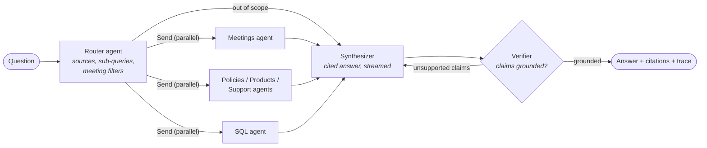
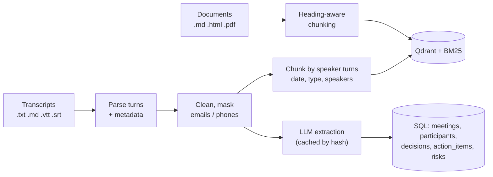

# MeetRAG

**A multi-agent RAG assistant that answers questions across meeting transcripts, documents _and_ a SQL database, with citations, a groundedness check, and a built-in evaluation harness.**

[](https://github.com/alexandreryba/meetrag/actions/workflows/ci.yml)


[](LICENSE)

> **Measured on a 67-question golden set:** 96.7% answer accuracy, 97.8% faithfulness to
> the retrieved evidence, 100% routing recall and 100% abstention on out-of-scope
> questions; meeting records extracted with 100% precision and recall on 25 annotated action
> items ([details](#evaluation)).

On a consulting engagement, most of the knowledge is spoken. The budget approved by the CFO,
the data source dropped during a workshop, the deadline promised in a weekly sync: all of it
lives in hours of meeting transcripts, and the answer to a real question usually also needs
the client's documentation or data. *"What was decided at the last steering committee?"*,
*"Why did we drop hourly meter data?"*, *"Which actions are due in November, and who owns
them?"*: finding the answer means re-reading recordings.

MeetRAG is the assistant I wanted as a data & AI consultant. It routes each question to
specialist agents, runs them in parallel over **meeting transcripts**, **documents** and a
**SQL database**, and only returns answers whose claims are backed by the evidence, with the
speaker, meeting and timestamp of every quote:

- **Multi-agent orchestration with LangGraph**: a router plans the sources, decomposes the
  question and sets meeting filters; document agents and a text-to-SQL agent run concurrently
  (`Send` fan-out); a synthesizer writes a cited answer; a verifier checks every claim and
  triggers a rewrite.
- **Meeting transcripts as a first-class source**: plain text, WebVTT (Teams, Zoom, Meet) and
  SRT; fillers and stutters removed; emails and phone numbers masked; chunks follow speaker
  turns; French and English.
- **Who, when, which meeting**: "the last steering committee", "in March", "what did Sophie
  say" become filters on meeting type, date range and speakers, applied by every retriever.
- **Meeting records in SQL**: an LLM extracts decisions, action items (owner, task, due date),
  risks and a summary per meeting into the database, cached by content hash, so "which actions
  are due in November?" is an exact query.
- **Hybrid search**: BM25 + dense embeddings (BGE, ONNX on CPU) fused with Reciprocal Rank
  Fusion, stored in **Qdrant**; corrective RAG with an LLM grader that rewrites the query when
  the evidence is insufficient.
- **Guarded text-to-SQL**: `sqlglot` validation (single read-only `SELECT`, enforced `LIMIT`),
  read-only connection with an authorizer, timeouts, and self-correction from SQL errors.
- **Abstention**: out-of-scope questions get an explicit "not found" instead of a hallucination.
- **Evaluation built in**: a 67-question golden set, an offline retrieval benchmark used as a
  **CI quality gate**, an extraction benchmark against hand-annotated meeting records, and an
  end-to-end LLM-as-judge evaluation (accuracy, faithfulness, routing, abstention, latency, cost)
  that can resume after an interruption.
- **Production-ready service**: FastAPI with Server-Sent Events streaming, a demo UI, Docker
  image with the index baked in, Terraform for **Cloud Run** (Secret Manager, Workload Identity
  Federation), GitHub Actions CI/CD.

> **The data is fictional, on purpose.** The demo is a consulting engagement at Voltaria Energy,
> an invented French electricity retailer: 10 meeting transcripts (5 in French, 5 in English),
> 16 internal documents and a 40,000-row database generated with a fixed seed. A synthetic
> dataset makes the right answer to every evaluation question known, which is what allows the
> system to be measured, and keeps any real client data out of a public repository. Point
> `MEETRAG_CORPUS_DIR` at your own folders to use your material ([data/README.md](data/README.md)).

---

## Use cases

MeetRAG targets one pattern that plain RAG handles badly: **questions whose answer is spread
across what was said in meetings, what is written in documents and what is in the data**.

| Who asks | Example question | Sources used |
|---|---|---|
| Engagement manager, preparing a steering committee | "What was decided at the last steering committee?" | meetings (filtered on the latest one) |
| Consultant joining mid-project | "Why did the team decide not to use hourly smart meter data?" | meetings |
| PMO | "Which action items are due in November, and who owns them?" | SQL (extracted records) |
| Client sponsor | "How did the phase 1 budget evolve since the kick-off?" | meetings, across several meetings |
| Business owner | "The pilot's save rate was compared with a target: what does the retention playbook set, and was it met?" | meetings + documents |
| Analyst | "Which offer did the pilot target, and what is its churn rate in the database?" | meetings + SQL |

What it deliberately does not do: open-ended chat, general-knowledge answers (out-of-scope
questions get an explicit "not found"), or any write action on documents or data.

The same architecture fits any organisation where decisions are made in meetings and must be
checked against documents and data: consulting and project teams, product teams (roadmap
reviews), IT service desks (incident reviews and runbooks), public services (committees and
regulations). Adapting it means replacing the corpus folders and pointing the `SqlDatabase`
port at the real warehouse, typically through a read-only replica.

---

## Architecture



Ingestion turns transcripts into both retrievable passages and structured records:



Each specialist agent is a small loop of its own: the document agents retrieve with hybrid
search, let an LLM grader keep the relevant passages and rewrite the query when they are
insufficient; the SQL agent generates a `SELECT`, which the guardrails validate and execute
read-only, and corrects it from the error message when it fails.

The code follows a **ports & adapters** layout: the agents depend on small interfaces (`LLM`,
`Embedder`, `VectorStore`, `SqlDatabase`, `Reranker`), and the composition root wires the
adapters. Swapping Qdrant for pgvector, or Claude for another model, touches one adapter. The
whole graph runs in tests with in-memory fakes and a scripted LLM, without network access.

| Layer | Package | Content |
|---|---|---|
| Domain | `meetrag.domain` | Pydantic models (`Chunk`, `SearchFilter`, `MeetingFilter`, `AnswerResult`...) and ports |
| Agents | `meetrag.agents` | Router, document agent, SQL agent, synthesizer, verifier, LangGraph wiring |
| Retrieval | `meetrag.retrieval` | BM25, RRF fusion, hybrid retriever, meeting catalog |
| Ingestion | `meetrag.ingestion` | Document loaders and chunker; transcript parser, cleaner and turn chunker; meeting-record extraction |
| Infrastructure | `meetrag.infrastructure` | Claude (Anthropic SDK, Vertex AI, Claude Code), LangChain adapter, FastEmbed, Qdrant, SQLite |
| Evaluation | `meetrag.evaluation` | Golden set, retrieval metrics, extraction scoring, LLM-as-judge |
| Interfaces | `meetrag.api`, `meetrag.cli` | FastAPI + SSE + demo UI, Typer CLI |

Design decisions are recorded as [ADRs](docs/adr/), including the
[meeting transcripts design](docs/adr/0006-meeting-transcripts.md).

---

## Evaluation

### End-to-end (LLM-as-judge)

`meetrag eval e2e` runs the full graph on the 67 questions, then grades each answer with an
LLM judge. For SQL questions the judge compares against the **result of a reference query
executed at evaluation time**, so reference figures are exact. Results (Claude Opus 5.5 for every role, run on 2026-10-28):

| Metric | Result | How it is measured |
|---|---|---|
| Answer accuracy | **96.7%** | Judge grades each answer against the reference: correct = 1, partial = 0.5 |
| Strict accuracy | **93.3%** | Fully correct answers: 56 of the 60 answerable questions, the other 4 are partial, none is wrong |
| Faithfulness | **97.8%** | Share of the answer's atomic claims supported by the retrieved evidence |
| Routing recall / precision | **100% / 90.8%** | Sources chosen by the router vs. expected sources (extra sources lower precision) |
| Abstention on out-of-scope questions | **100%** (7 / 7) | Explicit "not found" instead of an invented answer |
| False abstention | **0%** | Answerable questions wrongly declined |
| LLM calls per question | 4.3 | Router, graders, SQL agent, synthesizer, verifier |
| API-equivalent cost per question | $0.082 | Token usage × list price (judge excluded) |
| Latency p50 / p95 | 21 s / 36 s | See the note below |
| Errors | 0 | |

| Category | Questions | Accuracy | Faithfulness |
|---|---|---|---|
| **Meetings** (single meeting, across meetings, who said what, French question) | 12 | **100%** | 100% |
| **Meeting records** (action items, steering committees, attendance, via SQL) | 4 | **100%** | 96.4% |
| Policies | 10 | 95.0% | 97.7% |
| Products | 9 | 100% | 98.1% |
| Support | 8 | 100% | 97.6% |
| Analytics (SQL on business data) | 8 | 87.5% | 93.3% |
| Multi-source (meetings, documents and SQL combined) | 9 | 94.4% | 99.3% |
| Out of scope | 7 | 100% abstention | - |

**Error analysis.** The four answers graded "partial", checked by hand:

- *ana-07, mul-05* ("average monthly consumption / bill of Drive customers"): the reference
  averages all customer-months, while the SQL agent averaged each customer's monthly average
  (482.97 kWh, exact for that reading) or, in mul-05, declined to give a single figure. The
  question is ambiguous; a metric glossary (semantic layer) given to the SQL agent would remove
  this class of error. The same two questions were partial in the first run.
- *ana-08* (average resolution time of billing tickets closed in 2026): 6.84 days against
  6.80, from a slightly different filter.
- *pol-01* (remote days per week): the answer gives the right figure but omits the eligibility
  condition (after the probation period), which it cited in the previous run: the LLM grader
  kept a different set of passages. Expanding retrieved chunks to their sibling sections would
  make this more stable.

The prompts were not tuned on these questions: a rule written to fix ana-07 and mul-05 was
removed again so that the figures stay honest.

**Reading these numbers.** The run went through the Claude Code CLI on a Claude subscription
(`claude-code` provider): latency includes the CLI start-up of each of the ~4 sequential calls,
so it overstates what the API gives. The judge is the same model as the system, which can
favour its own style; `MEETRAG_JUDGE_MODEL` lets you use another one. The dataset is small and
clean; the difficulty lies in routing, cross-source and cross-meeting questions, attribution
and abstention, which is what the golden set targets. Full report: [reports/e2e.md](reports/e2e.md).

### Meeting-record extraction (offline)

`meetrag eval extraction` compares the cached LLM extractions with hand-annotated records of
the 10 meetings ([eval/meeting_records_gold.jsonl](eval/meeting_records_gold.jsonl)). An action
item matches when the owner is the same person and the tasks are paraphrases (embedding cosine
similarity of at least 0.70; true matches score 0.78 or more, median 0.92, while the closest
wrong pair scores 0.73).

| Metric | Result |
|---|---|
| Action items: precision / recall | **100% / 100%** (25 / 25) |
| Due dates correct on matched items | 96% (24 / 25) |
| Decisions found | 100% (16 / 16 annotated; 21 extracted) |

The one date mismatch is debatable: for "staff six agents for the go-live week", the model
resolved the date to the go-live day decided in the same meeting, where the annotation leaves
it empty. The annotation was not changed after seeing the result. Report:
[reports/extraction.md](reports/extraction.md).

### Retrieval (offline, runs in CI)

`meetrag eval retrieval`, on the 48 golden-set questions that have labelled source documents
(123 chunks, global search across all sources). The CI fails if hybrid MRR@10 drops below 0.90.

| Mode | Hit@1 | Hit@5 | Recall@5 | MRR@10 | nDCG@5 | Latency |
|---|---|---|---|---|---|---|
| BM25 | 0.833 | 0.917 | 0.899 | 0.875 | 0.860 | 0.1 ms |
| Dense (bge-small-en-v1.5) | 0.875 | **0.979** | **0.934** | **0.923** | 0.896 | 12 ms |
| **Hybrid (BM25 + dense, RRF)** | **0.896** | 0.958 | 0.931 | 0.918 | 0.896 | 15 ms |
| Hybrid + cross-encoder rerank | 0.854 | 0.958 | 0.913 | 0.906 | 0.880 | 1 to 15 s |

What the numbers say, and what was decided:

- **Dense and hybrid are on par** on this benchmark. Hybrid stays the default because BM25 is
  what reliably matches exact identifiers (offer codes, amounts, tool and people names), for
  3 ms more; it also has the best Hit@1.
- **The cross-encoder is off by default**: it improves no metric and costs at least a second
  per query on CPU ([ADR 0003](docs/adr/0003-hybrid-retrieval-without-reranker.md)).
- **The embedding model was chosen by measurement**: two multilingual models did worse than
  `bge-small-en-v1.5`, including on the French meetings ([ADR 0006](docs/adr/0006-meeting-transcripts.md)).
- **Indexing the English meeting type in every transcript chunk** raised meeting Recall@5 from
  0.744 to 0.811: an English question about a "steering committee" now matches a French
  "Comité de pilotage".

---

## Quickstart

Requirements: Python 3.11+ and [uv](https://docs.astral.sh/uv/).

```bash
git clone https://github.com/alexandreryba/meetrag.git && cd meetrag
uv sync --all-extras
cp .env.example .env            # then set ANTHROPIC_API_KEY (or use your Claude subscription, below)

uv run meetrag ingest           # index transcripts and documents, build the database (~20 s)
uv run meetrag eval retrieval   # offline benchmark, no API key needed
uv run meetrag ask "What was decided at the last steering committee?"
uv run meetrag serve            # API + demo UI on http://127.0.0.1:8000
```

Meeting records (decisions, action items, risks) are already extracted in `data/insights/`.
After adding or changing transcripts, run `uv run meetrag extract` (one LLM call per new or
changed meeting; unchanged meetings come from the cache).

With Docker:

```bash
docker compose up --build       # http://localhost:8080
```

### LLM providers

| Provider | Settings |
|---|---|
| Claude API (default) | `ANTHROPIC_API_KEY`, `MEETRAG_LLM_MODEL=claude-opus-5-5` |
| Claude on Vertex AI | `MEETRAG_LLM_PROVIDER=anthropic-vertex`, `MEETRAG_GCP_PROJECT`, Application Default Credentials |
| Any LangChain chat model | `MEETRAG_LLM_PROVIDER=langchain`, `MEETRAG_LLM_MODEL=google_genai:gemini-2.5-flash` (install the provider package) |
| Claude subscription, local only | `uv sync --extra subscription`, `MEETRAG_LLM_PROVIDER=claude-code`: runs through your Claude Code login (Pro or Max plan), no API key |

The `claude-code` provider drives the Claude Code CLI through the
[Claude Agent SDK](https://pypi.org/project/claude-agent-sdk/), one tool-free turn per call,
without loading your Claude Code settings or MCP servers. It is meant for development and
evaluation on your own machine: subscription access is personal, so the deployed service uses
the API or Vertex AI. Each call starts a CLI process, which adds about 2 s of latency; when the
subscription's usage limit is reached, an evaluation stops cleanly and `--resume` continues it.

The router, graders, SQL agent and verifier use `MEETRAG_LLM_FAST_MODEL` with low reasoning
effort; the synthesizer uses `MEETRAG_LLM_MODEL`. Set the fast model to `claude-haiku-5-5` to cut
the cost of an answer. Claude refusals are handled with the server-side `fallbacks` feature and,
if still declined, turned into an abstention rather than an error.

---

## API

| Method | Path | Description |
|---|---|---|
| `POST` | `/v1/ask` | Answer a question: `{"question": "..."}` → answer, citations, evidence, trace, usage |
| `POST` | `/v1/ask/stream` | Same, as Server-Sent Events: `trace`, `token`, `reset`, `final` |
| `GET` | `/v1/sources` | Available sources and chunk counts |
| `GET` | `/healthz`, `/readyz` | Liveness and readiness (index loaded) |
| `GET` | `/` | Demo UI |
| `GET` | `/docs` | OpenAPI documentation |

```bash
curl -s localhost:8000/v1/ask -H 'Content-Type: application/json' \
  -d '{"question": "Which action items are due in November 2026, and who owns them?"}'
```

Set `MEETRAG_API_KEY` to require an `X-API-Key` header on `/v1/*`.

---

## Deployment on Google Cloud

`deploy/terraform` provisions Artifact Registry, a Cloud Run service (2 vCPU, 2 GiB, scale to
zero), Secret Manager secrets, dedicated runtime and deployer service accounts, and **Workload
Identity Federation** so GitHub Actions deploys without any stored key. The Docker image ships
with the embedding model, the index and the meeting records, so a cold start downloads
nothing and calls no model.

Step-by-step guide: [docs/deployment.md](docs/deployment.md).

---

## Development

```bash
make check            # ruff + mypy --strict + pytest (what CI runs)
make test             # 92 tests, ~10 s, fully offline
uv run pre-commit install
```

- **Tests**: unit tests for transcript parsing (all formats), cleaning and PII masking, turn
  chunking, the meeting catalog and search filters, BM25, RRF, SQL guardrails, meeting records
  and their cache, metrics and the LLM adapters; integration tests that run the full LangGraph
  pipeline (including meeting filters), the API, the CLI and the evaluations against the real
  corpus, with a scripted LLM. Coverage: 82%.
- **CI** (`.github/workflows/ci.yml`): lint, types and tests on Python 3.11 to 3.13, retrieval
  quality gate with real embeddings, Docker build.
- **CD** (`deploy.yml`): on a `v*` tag, build, push to Artifact Registry, deploy to Cloud Run,
  smoke test.
- **Evaluation** (`eval.yml`): manual end-to-end evaluation, report in the job summary.

```
src/meetrag/
├── agents/          router, document & SQL agents, synthesizer/verifier, graph
├── api/             FastAPI app, schemas, static demo UI
├── demo/            deterministic generator of the analytics database
├── domain/          models and ports
├── evaluation/      golden set, retrieval metrics, extraction scoring, LLM judge
├── infrastructure/  LLM, embeddings, reranker, Qdrant, SQLite adapters
├── ingestion/       loaders, chunkers, transcripts, meeting records, pipeline
├── retrieval/       BM25, RRF, hybrid retriever, meeting catalog
├── cli.py           Typer CLI
├── config.py        settings (env vars, prefix MEETRAG_)
├── container.py     composition root
└── service.py       application service (ask / stream)
data/corpus/         meetings, policies, products, support
data/insights/       cached meeting records (decisions, action items, risks)
eval/                golden set and annotated meeting records
deploy/terraform/    Cloud Run infrastructure
docs/adr/            architecture decision records
```

## Roadmap

- Permission-aware retrieval: only search the meetings a user attended (participants are
  already in the chunk metadata).
- Connectors to Teams, Google Meet and Zoom to ingest transcripts as meetings end, with
  incremental indexing by content hash.
- Audio transcription and speaker diarization (Whisper) for recordings without a transcript.
- Metric glossary (semantic layer) for the SQL agent, and sibling-section expansion of
  retrieved chunks, from the error analysis.
- Conversation memory (LangGraph checkpointer) for follow-up questions.
- BigQuery adapter for the `SqlDatabase` port; OpenTelemetry tracing of agent steps.

---

## En bref (FR)

MeetRAG est un **assistant RAG multi-agents** pensé pour les équipes qui passent leurs journées
en réunion : il interroge des **transcripts de réunions** (texte, VTT, SRT, en français ou en
anglais), des **documents** et une **base SQL**, et cite chaque information avec la personne, la
réunion et l'horodatage. Un agent routeur (LangGraph) choisit les sources et comprend « le
dernier comité de pilotage » ou « ce qu'a dit Sophie en mars » ; des agents spécialisés
cherchent en parallèle (recherche hybride BM25 + vecteurs, Qdrant ; text-to-SQL sécurisé) ; un
agent de synthèse rédige la réponse, vérifiée par un agent de contrôle des hallucinations. Les
décisions et actions de chaque réunion sont extraites en base SQL. Sur 67 questions : 97 %
de réponses correctes, 98 % de fidélité aux sources, 100 % de questions hors
périmètre refusées ; extraction des actions : 100 % de précision et de rappel. Le projet
inclut CI avec quality gate, API FastAPI en streaming, Docker et Terraform pour Cloud Run.

## License

[MIT](LICENSE)
