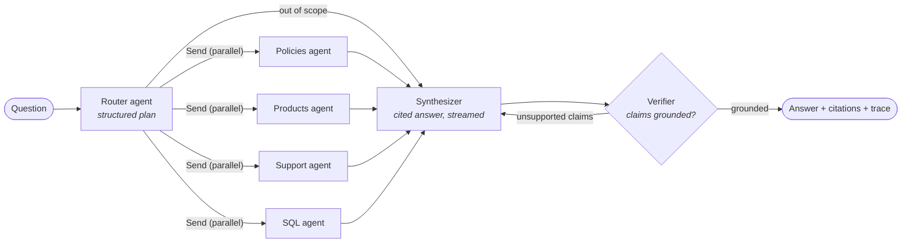
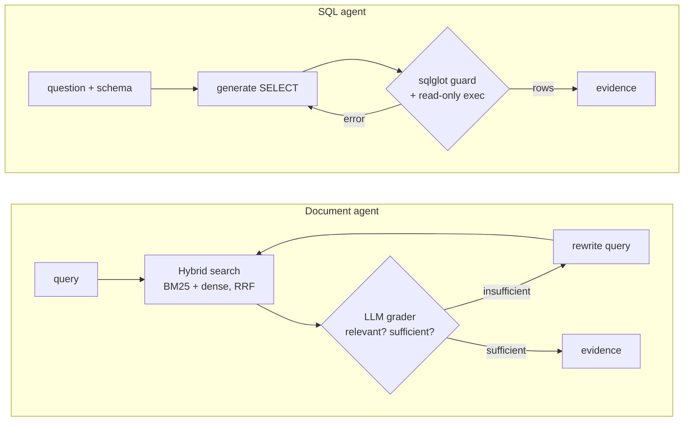

# PolyRAG

**A multi-agent RAG assistant that answers questions across documents _and_ a SQL database, with citations, a groundedness check, and a built-in evaluation harness.**

[](https://github.com/alexandreryba/polyrag/actions/workflows/ci.yml)


[](LICENSE)

Most RAG demos stop at "embed PDFs, retrieve top-k, prompt an LLM". Real enterprise questions
are messier: *"Which offer churns the most, and what can a retention agent propose to those
customers?"* needs a **SQL query** on business data **and** a **procedure** from the support
wiki, combined into one answer you can trust.

PolyRAG routes each question to specialist agents, runs them in parallel, and only returns
answers whose claims are backed by the retrieved evidence:

- **Multi-agent orchestration with LangGraph**: a router plans the sources and decomposes the
  question; document agents and a text-to-SQL agent run concurrently (`Send` fan-out); a
  synthesizer writes a cited answer; a verifier checks every claim and triggers a rewrite.
- **Multi-source retrieval**: three document collections (HR & security policies, product
  documentation, support procedures) and an analytics database (customers, consumption, tickets).
- **Hybrid search**: BM25 + dense embeddings (BGE, ONNX on CPU) fused with Reciprocal Rank
  Fusion, stored in **Qdrant**; optional cross-encoder reranking.
- **Corrective RAG**: an LLM grader filters retrieved passages and rewrites the query when the
  evidence is insufficient.
- **Guarded text-to-SQL**: `sqlglot` validation (single read-only `SELECT`, enforced `LIMIT`),
  read-only connection with an authorizer, timeouts, and self-correction from SQL errors.
- **Abstention**: out-of-scope questions get an explicit "not found" instead of a hallucination.
- **Evaluation built in**: a 46-question golden set, offline retrieval benchmark used as a **CI
  quality gate**, and an end-to-end LLM-as-judge evaluation (accuracy, faithfulness, routing,
  abstention, latency, cost).
- **Production-ready service**: FastAPI with Server-Sent Events streaming, a demo UI, Docker
  image with the index baked in, Terraform for **Cloud Run** (Secret Manager, Workload Identity
  Federation), GitHub Actions CI/CD.

> The knowledge base belongs to **Voltaria Energy**, a fictional French electricity retailer
> created for this project (16 documents and a 40,000-row SQLite database generated with a
> fixed seed). Point `POLYRAG_CORPUS_DIR` at your own folders to use your documents.

---

## Architecture



Each specialist agent is a small loop of its own:



The code follows a **ports & adapters** layout: the agents depend on small interfaces (`LLM`,
`Embedder`, `VectorStore`, `SqlDatabase`, `Reranker`), and the composition root wires the
adapters. Swapping Qdrant for pgvector, or Claude for another model, touches one adapter. The
whole graph runs in tests with in-memory fakes and a scripted LLM, without network access.

| Layer | Package | Content |
|---|---|---|
| Domain | `polyrag.domain` | Pydantic models (`Chunk`, `Evidence`, `AnswerResult`...) and ports |
| Agents | `polyrag.agents` | Router, document agent, SQL agent, synthesizer, verifier, LangGraph wiring |
| Retrieval | `polyrag.retrieval` | BM25, RRF fusion, hybrid retriever |
| Ingestion | `polyrag.ingestion` | Loaders (Markdown, HTML, PDF), heading-aware chunker, pipeline |
| Infrastructure | `polyrag.infrastructure` | Claude (Anthropic SDK, Vertex AI), LangChain adapter, FastEmbed, Qdrant, SQLite |
| Evaluation | `polyrag.evaluation` | Golden set, retrieval metrics, LLM-as-judge |
| Interfaces | `polyrag.api`, `polyrag.cli` | FastAPI + SSE + demo UI, Typer CLI |

Design decisions are recorded as [ADRs](docs/adr/).

---

## Evaluation

### Retrieval (offline, runs in CI)

`polyrag eval retrieval`, on the 33 golden-set questions that have labelled source documents
(98 chunks, global search across all collections). The CI fails if hybrid MRR@10 drops below 0.90.

| Mode | Hit@1 | Hit@3 | Recall@5 | MRR@10 | nDCG@5 | Latency |
|---|---|---|---|---|---|---|
| BM25 | 0.879 | 0.970 | 0.970 | 0.923 | 0.930 | 0.1 ms |
| Dense (bge-small-en-v1.5) | **0.970** | 1.000 | 0.985 | **0.985** | **0.969** | 14 ms |
| **Hybrid (BM25 + dense, RRF)** | 0.939 | 0.970 | **1.000** | 0.961 | 0.960 | 13 ms |
| Hybrid + cross-encoder rerank | 0.909 | 1.000 | 0.985 | 0.949 | 0.951 | 1,057 ms |

What the numbers say, and what was decided:

- **Hybrid search is the default** because it is the only mode with perfect Recall@5. Agents
  receive the top 5 passages and an LLM grader filters them, so recall matters more than the
  rank of the first hit.
- **The cross-encoder is off by default.** On this corpus it adds about 1 s per query on CPU and
  does not improve any metric. It remains one setting away (`POLYRAG_RERANKER_MODEL`) for larger
  or noisier corpora. See [ADR 0003](docs/adr/0003-hybrid-retrieval-without-reranker.md).
- The corpus is small and clean, so all modes score high; the benchmark is mainly a regression
  gate for chunking and embedding changes.

Full report: [reports/retrieval.md](reports/retrieval.md).

### End-to-end (LLM-as-judge)

`polyrag eval e2e` runs the full graph on the 46 questions (policies, products, support,
analytics, multi-source and out-of-scope) and reports:

| Metric | How it is measured |
|---|---|
| Answer accuracy | Judge compares the answer with a reference. For SQL questions the **reference query is executed**, so the reference figures are exact |
| Faithfulness | Share of the answer's atomic claims supported by the retrieved evidence |
| Routing precision / recall | Sources chosen by the router vs. expected sources |
| Abstention accuracy | Out-of-scope questions answered with an explicit "not found" |
| Latency p50 / p95, cost, LLM calls | Measured per question (token usage × model pricing) |

The report is written to `reports/e2e.md`. Run it with an API key (see [Quickstart](#quickstart)),
or from the **End-to-end evaluation** GitHub workflow.

---

## Quickstart

Requirements: Python 3.11+ and [uv](https://docs.astral.sh/uv/).

```bash
git clone https://github.com/alexandreryba/polyrag.git && cd polyrag
uv sync --all-extras
cp .env.example .env            # then set ANTHROPIC_API_KEY

uv run polyrag ingest           # index 16 documents + build the analytics database (~10 s)
uv run polyrag eval retrieval   # offline benchmark, no API key needed
uv run polyrag ask "Which offer has the highest churn rate, and what can a retention agent propose?"
uv run polyrag serve            # API + demo UI on http://127.0.0.1:8000
```

With Docker:

```bash
docker compose up --build       # http://localhost:8080
```

### LLM providers

| Provider | Settings |
|---|---|
| Claude API (default) | `ANTHROPIC_API_KEY`, `POLYRAG_LLM_MODEL=claude-opus-5-5` |
| Claude on Vertex AI | `POLYRAG_LLM_PROVIDER=anthropic-vertex`, `POLYRAG_GCP_PROJECT`, Application Default Credentials |
| Any LangChain chat model | `POLYRAG_LLM_PROVIDER=langchain`, `POLYRAG_LLM_MODEL=google_genai:gemini-2.5-flash` (install the provider package) |
| Claude subscription, local only | `uv sync --extra subscription`, `POLYRAG_LLM_PROVIDER=claude-code`: runs through your Claude Code login (Pro or Max plan), no API key |

The `claude-code` provider drives the Claude Code CLI through the
[Claude Agent SDK](https://pypi.org/project/claude-agent-sdk/), one tool-free turn per call,
without loading your Claude Code settings or MCP servers. It is meant for development and
evaluation on your own machine: subscription access is personal, so the deployed service uses
the API or Vertex AI. Each call starts a CLI process, which adds about 2 s of latency.

The router, graders, SQL agent and verifier use `POLYRAG_LLM_FAST_MODEL` with low reasoning
effort; the synthesizer uses `POLYRAG_LLM_MODEL`. Set the fast model to `claude-haiku-5-5` to cut
the cost of an answer. Claude refusals are handled with the server-side `fallbacks` feature and,
if still declined, turned into an abstention rather than an error.

---

## API

| Method | Path | Description |
|---|---|---|
| `POST` | `/v1/ask` | Answer a question: `{"question": "..."}` → answer, citations, evidence, trace, usage |
| `POST` | `/v1/ask/stream` | Same, as Server-Sent Events: `trace`, `token`, `reset`, `final` |
| `GET` | `/v1/sources` | Available sources and chunk counts |
| `GET` | `/healthz`, `/readyz` | Liveness and readiness (index loaded) |
| `GET` | `/` | Demo UI |
| `GET` | `/docs` | OpenAPI documentation |

```bash
curl -s localhost:8000/v1/ask -H 'Content-Type: application/json' \
  -d '{"question": "How many P1 tickets were opened in 2026, and what first-response time is required?"}'
```

Set `POLYRAG_API_KEY` to require an `X-API-Key` header on `/v1/*`.

---

## Deployment on Google Cloud

`deploy/terraform` provisions Artifact Registry, a Cloud Run service (2 vCPU, 2 GiB, scale to
zero), Secret Manager secrets, dedicated runtime and deployer service accounts, and **Workload
Identity Federation** so GitHub Actions deploys without any stored key. The Docker image ships
with the embedding model and the index, so a cold start downloads nothing.

Step-by-step guide: [docs/deployment.md](docs/deployment.md).

---

## Development

```bash
make check            # ruff + mypy --strict + pytest (what CI runs)
make test             # 56 tests, ~10 s, fully offline
uv run pre-commit install
```

- **Tests**: unit tests for chunking, BM25, RRF, SQL guardrails, metrics and the Claude adapter;
  integration tests that run the full LangGraph pipeline, the API, the CLI and both evaluations
  against the real corpus, with a scripted LLM. Coverage: 83%.
- **CI** (`.github/workflows/ci.yml`): lint, types and tests on Python 3.11 to 3.13, retrieval
  quality gate with real embeddings, Docker build.
- **CD** (`deploy.yml`): on a `v*` tag, build, push to Artifact Registry, deploy to Cloud Run,
  smoke test.
- **Evaluation** (`eval.yml`): manual end-to-end evaluation, report in the job summary.

```
src/polyrag/
├── agents/          router, document & SQL agents, synthesizer/verifier, graph
├── api/             FastAPI app, schemas, static demo UI
├── demo/            deterministic generator of the analytics database
├── domain/          models and ports
├── evaluation/      golden set, retrieval metrics, LLM judge
├── infrastructure/  LLM, embeddings, reranker, Qdrant, SQLite adapters
├── ingestion/       loaders, chunker, pipeline
├── retrieval/       BM25, RRF, hybrid retriever
├── cli.py           Typer CLI
├── config.py        settings (env vars, prefix POLYRAG_)
├── container.py     composition root
└── service.py       application service (ask / stream)
data/corpus/         Voltaria knowledge base (policies, products, support)
eval/golden_set.jsonl
deploy/terraform/    Cloud Run infrastructure
docs/adr/            architecture decision records
```

## Roadmap

- Conversation memory (LangGraph checkpointer) for follow-up questions.
- BigQuery adapter for the `SqlDatabase` port.
- Qdrant sparse vectors to move BM25 into the vector database for large corpora.
- OpenTelemetry tracing of agent steps.

---

## En bref (FR)

PolyRAG est un **assistant RAG multi-agents** : un agent routeur (LangGraph) choisit les sources,
des agents spécialisés interrogent en parallèle trois bases documentaires (recherche hybride
BM25 + vecteurs, Qdrant) et une base SQL (text-to-SQL sécurisé), puis un agent de synthèse
rédige une réponse sourcée, vérifiée par un agent de contrôle des hallucinations. Le projet
inclut un jeu d'évaluation de 46 questions, un banc d'essai de la recherche utilisé comme
**quality gate en CI**, une évaluation de bout en bout par LLM juge, une API FastAPI en
streaming, une image Docker et un déploiement **Cloud Run** en Terraform.

## License

[MIT](LICENSE)
